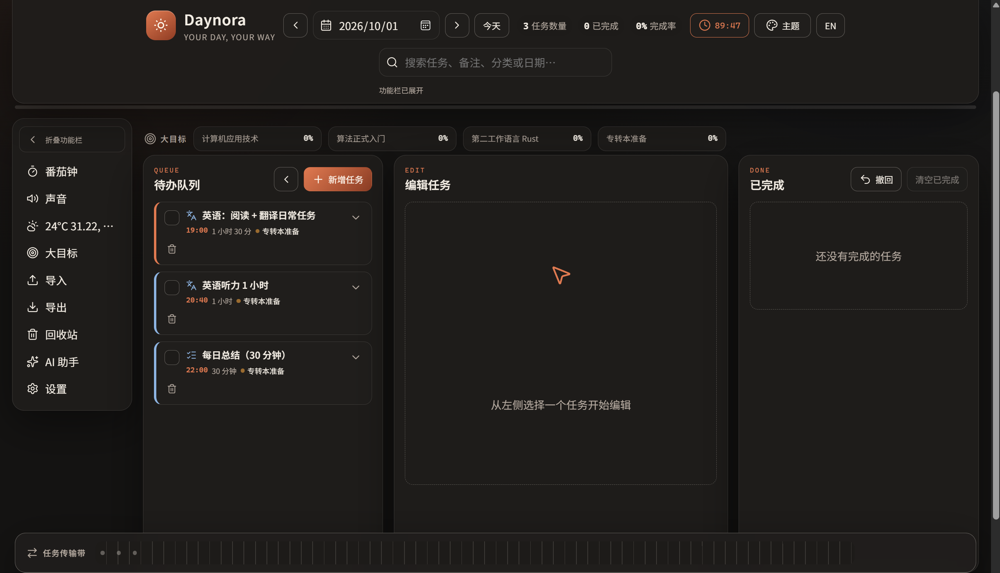
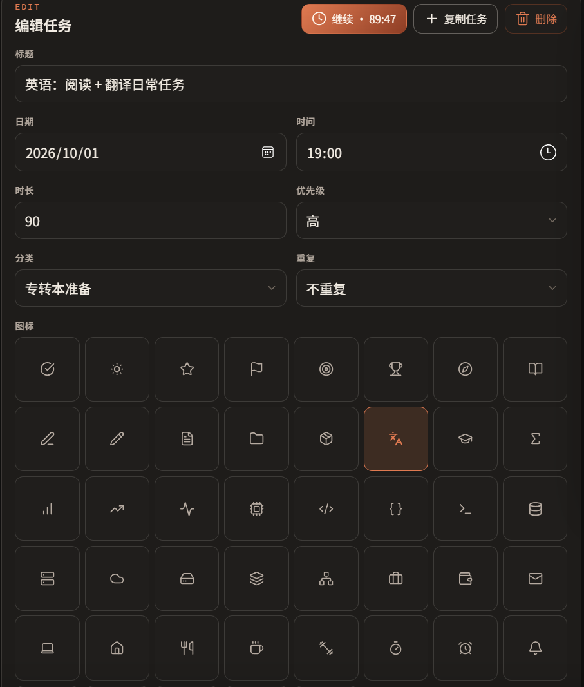
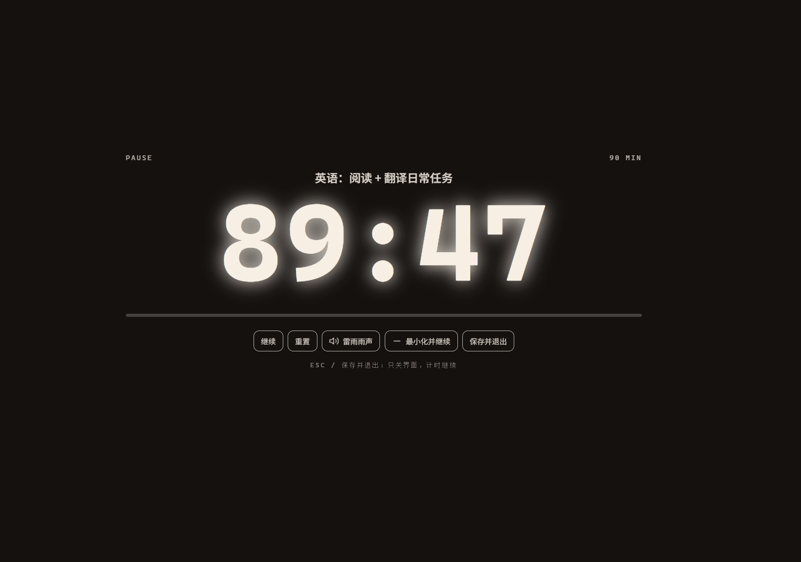
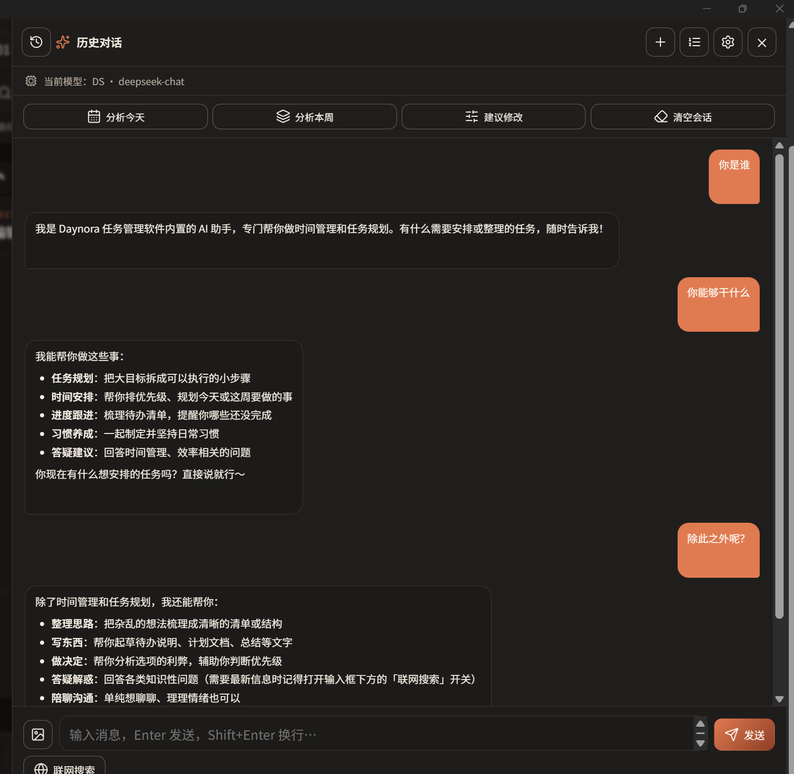
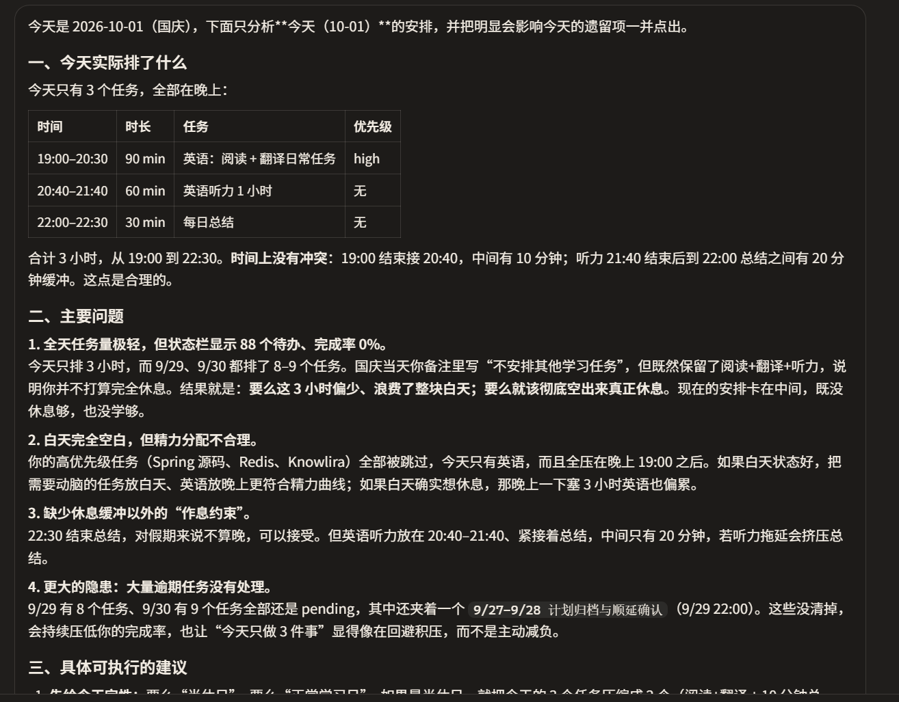
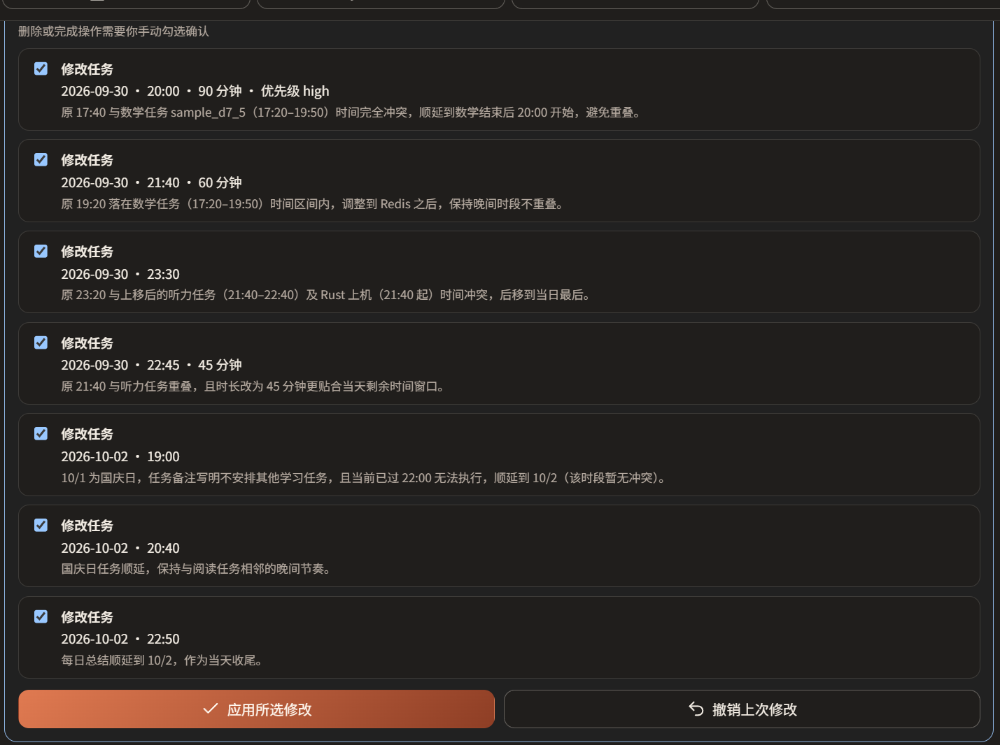

<div align="center">

# Daynora

**Your Day, Your Way · 让每一天都有安排**

本地优先的 Windows 个人任务管理器：三栏式任务流、目标追踪、番茄钟专注与可接入自有 API Key 的 AI 助手。


</div>

---

## 界面预览

> 主界面



> 任务编辑



> 倒计时



> AI_chat



> AI_suggestions



> AI_operate_app



---

## 核心功能

### 任务与规划

- 三栏工作流：待办队列 → 编辑区 → 已完成，支持拖拽排序、复制、回收站与一键撤销
- 任务字段：日期、开始时间、时长、优先级、分类、重复规则（每天 / 每周 / 工作日）、备注、图标
- 大目标管理：目标进度、截止日期、关联任务（全部任务可搜索勾选，随时增删）
- 全局搜索、多日视图、导入导出（JSON / CSV / Markdown）与打印

### 专注计时

- 番茄钟全屏界面，支持暂停、继续、重置、环境音与三种时钟样式
- **计时按真实时间戳计算**：窗口最小化、被系统节流都不会丢时间
- **每个任务独立保留计时快照**：退出界面、甚至关闭软件后重新打开，都能从原剩余时间继续
- 「最小化并继续」：直接隐藏到托盘，在桌面用其他软件时继续计时，结束时系统通知

### AI 助手（自备 API Key）

- 右侧抽屉式对话界面，与任务面板互不干扰；抽屉宽度可拖动调整
- 支持多会话：新建对话、历史会话搜索、随时切回旧对话继续聊；新会话由模型自动生成短标题
- 回答按 Markdown 渲染：表格、列表、引用、**代码块语法高亮 + 一键复制**、LaTeX 公式（KaTeX）
- 任务分析：一键「分析今天 / 分析本周」，把任务快照交给模型给出可执行建议
- 计划修改：模型通过 Function Calling 提出结构化修改建议，用户在差异列表中勾选确认后才会写入，并支持撤销
- 提醒建议：AI 可以建议提醒时间，确认后由应用在运行期间到点通知
- 流式输出、随时停止、错误重试、Token 用量显示

### 数据与隐私

- 全部数据保存在本机 SQLite（`%APPDATA%\com.knowlira.daynora\daynora.db`）
- 任务数据与 AI 密钥使用 **Windows DPAPI** 加密，密钥不会回显、不会写入日志
- 发送给 AI 的快照默认为「任务标题 / 日期 / 时间 / 时长 / 优先级 / 分类 / 完成状态」，**不含备注**
- 首次使用 AI 前展示隐私说明，需明确同意

---

## 技术栈

| 层 | 选型 |
| --- | --- |
| 桌面壳 | Tauri 2（WebView2） |
| 前端 | Vite 7 + TypeScript 5（无框架，原生 DOM 渲染） |
| 后端 | Rust 2021，rusqlite（SQLite）、DPAPI 加密 |
| AI 网络层 | reqwest + rustls + eventsource-stream（SSE） |
| 富文本渲染 | marked + DOMPurify + KaTeX + highlight.js |
| 图标 / 字体 | Lucide（ISC）、Noto Sans SC（OFL） |

AI 相关代码集中在 [`src-tauri/src/ai/`](src-tauri/src/ai)，前端界面集中在 [`src/features/`](src/features)，便于单独阅读或复用到其他项目。

---

## 快速开始

环境要求：Windows 10/11、Node.js ≥ 22.13、Rust stable（MSVC 工具链）、WebView2 运行时。

```powershell
# 1. 安装前端依赖
npm install

# 2. 启动桌面开发版（同时运行 Vite 与 Tauri）
npm run tauri:dev

# 仅预览前端界面（浏览器模式，AI 为本地模拟）
npm run dev
```

打包安装程序：

```powershell
npm run tauri:build
# 产物：src-tauri/target/release/bundle/nsis/Daynora_<version>_x64-setup.exe
```

---

## 配置 AI 助手

1. 打开左侧「AI 助手」→ 顶栏切换到「AI 设置」
2. 添加提供商：DeepSeek / OpenAI / Moonshot / SiliconFlow / OpenRouter / 自定义（任意 OpenAI 兼容接口）
3. 填写 Base URL、模型名与 API Key（Base URL 形如 `https://api.deepseek.com/v1`）
4. 点「测试」确认连通后保存，即可回到对话页使用

> 没有 API Key 也可以先选「本地模拟」提供商，完整体验流式输出、代码高亮与修改建议流程。

---

## 项目结构

```text
daynora/
├─ src/                       前端（Vite + TypeScript）
│  ├─ app.ts                  应用装配与事件分发
│  ├─ features/
│  │  ├─ ai-panel.ts          AI 抽屉面板（会话、流式对话、提供商设置）
│  │  ├─ ai.ts                AI 公共类型与展示工具
│  │  ├─ markdown.ts          Markdown / 公式 / 代码高亮渲染
│  │  ├─ focus.ts             计时核心（纯逻辑，可测试）
│  │  ├─ focus-controller.ts  多任务计时快照与生命周期
│  │  └─ audio.ts weather.ts search.ts zoom.ts notifications.ts
│  ├─ store/repository.ts     数据仓库（Tauri / localStorage / 内存三种实现）
│  └─ styles.css              主题与布局
├─ src-tauri/                 桌面壳与 Rust 后端
│  ├─ src/ai/                 云端 AI 网络层（独立目录，便于学习复用）
│  ├─ src/db.rs               SQLite、备份与数据访问
│  ├─ src/security.rs         DPAPI 加解密
│  └─ src/system.rs           托盘、通知、开机自启
├─ tests/                     Node 原生单元测试
└─ docs/                      架构说明与截图
```

---

## 测试

```powershell
npm run test:unit    # 前端逻辑单元测试（任务、导出、天气、计时等）
cd src-tauri; cargo test   # 后端测试（AI 模拟端点、会话存储、计划修改）
```

---

## 路线图

- [ ] 多提供商模型参数（温度、最大 Token）可视化配置
- [ ] 跨会话长期记忆与"继续上次分析"
- [ ] 数据导出为加密备份、云同步（可选）
- [ ] 深色 / 复古主题细节打磨与动效
- [ ] 前端代码分割，缩短冷启动时间

---

## 第三方组件

图标 Lucide（ISC）、字体 Noto Sans SC（OFL）、KaTeX（MIT）、marked（MIT）、DOMPurify（MPL-2.0）、highlight.js（BSD-3-Clause）等，完整清单见 [THIRD_PARTY_NOTICES.md](THIRD_PARTY_NOTICES.md)。

---

<div align="center">

程序由 **DeepSeek** 和 **知澜程序员（Knowlira Developer）** 共同构建。

</div>
